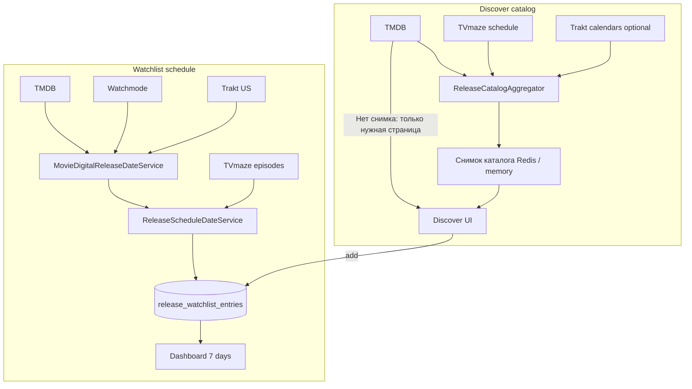

# Архитектура модуля Releases

> **Версия:** 1.4
> **Дата:** 2026-11-05
> **Источник:** порт логики OnTrash / NextScene + multi-API catalog/schedule

---

## Назначение

Модуль **Releases** — календарь цифровых релизов фильмов и сериалов с персональным watchlist. Каталог Discover и даты расписания собираются из нескольких бесплатных API (TMDB + TVmaze + опционально Trakt/Watchmode).

Профили: веб-продукт с публичным каталогом API и персональным интерфейсом после входа. Изменение загрузки не затрагивает SaaS-биллинг, платежи, AI, миграции БД и публикацию продукта — соответствующие условные правила здесь неприменимы.

---

## Компоненты

| Слой | Путь | Ответственность |
|------|------|-----------------|
| TMDB client | `src/lib/integrations/tmdb/client.ts` | Discover/upcoming, episodes; окно дат через `from`/`toExclusive` |
| TMDB digital parse | `src/lib/integrations/tmdb/digital-release-dates.ts` | Парсинг TMDB release_dates (type-4 + SVOD type-6); см. `MOVIE_DIGITAL_RELEASE_ARCHITECTURE.md` |
| Movie digital aggregator | `src/lib/services/movie-digital-release-date-service.ts` | Cross-source min: TMDB + Watchmode + Trakt → earliest digital |
| TVmaze client | `src/lib/integrations/tvmaze/client.ts` | Web/broadcast schedule, lookup by IMDb, episodes (`airstamp`) |
| Trakt client | `src/lib/integrations/trakt/client.ts` | Bulk `/calendars/all/*` (optional; `TRAKT_CLIENT_ID` = `trakt-api-key`; OAuth не нужен); 429 → `Retry-After`; обязательный `User-Agent` |
| Watchmode client | `src/lib/integrations/watchmode/client.ts` | Digital movie date (optional; `WATCHMODE_API_KEY`) |
| Catalog aggregator | `src/lib/services/release-catalog-aggregator.ts` | Merge TMDB + TVmaze + Trakt → `CatalogPage`; dedup `{type}:{tmdbId}`; **то же окно дат**, что и TMDB fetch |
| Schedule dates | `src/lib/services/release-schedule-date-service.ts` | Единая логика дат: movie digital / show next episode |
| Watchlist service | `src/lib/services/release-watchlist-service.ts` | CRUD; чтение только из БД, resolve dates при add |
| Watchlist refresh | `src/lib/services/release-watchlist-refresh-service.ts` | Batch refresh movies **и** shows |
| Precompute | `src/lib/services/releases-precompute-service.ts` | Прогрев merged catalog через `refreshUpcoming`; сбой одной комбинации не останавливает остальные |
| API content | `src/app/api/releases/content/*` | Catalog endpoints (`upcoming` → aggregator) |
| API watchlist | `src/app/api/releases/watchlist/*` | Авторизованный watchlist |
| UI | `src/[locale]/releases/*` | Dashboard + Discover + Watchlist |
| Client utils | `src/modules/releases/utils.ts` | `buildWeekSchedule`, `localDateKey` (браузерная TZ) |
| DB | `release_watchlist_entries` | Персистентный watchlist |

---

## Поток данных

---

## Даты расписания

| Тип | Приоритет источников |
|-----|----------------------|
| **movie** | `MovieDigitalReleaseDateService`: min(TMDB all digital-like, Watchmode, Trakt US) в окне |
| **show** | TMDB episode в окне → TVmaze episodes (`airstamp`) |

Точки применения: `ReleaseWatchlistService.add`, modal add, `ReleaseWatchlistRefreshService.refreshSchedules`, preview в aggregator.

`GET /api/releases/watchlist` возвращает сохранённые даты `release_watchlist_entries`, без синхронного вызова `resolveDisplay` для каждого фильма и без обновлений БД при чтении. После отправки ответа `after()` проверяет устаревание расписания и ставит существующую задачу обновления в очередь; ошибки постановки логируются. Worker обновляет фильмы и сериалы каждый час. Без Redis/worker автоматическое обновление расписания не выполняется; последнее сохранённое значение остаётся доступным.

**TZ:** в БД ISO/date strings; UI группирует по `zonedDateKey` / `calendarDateKey`. На карточке Discover/Watchlist и в модалке:
- **movie** — `releaseDate` (цифровой);
- **show** — `nextEpisode` (премьера сезона при E1, иначе S·E + дата).

---

## Кэш

| Ключ / область | TTL | Назначение |
|----------------|-----|------------|
| `releases:catalog:pool:v6:{lang}:{type}:{sort}:{genre}:{from}:{toExclusive}` | свежесть ~30m; хранение ≥24h | `{items, updatedAt}`; общий пул с пагинацией |
| TMDB upcoming, ключ из `buildUpcomingCacheKey` | ~30m | Страницы TMDB; только полный успешный результат |
| `tmdb:movie:{id}:catalog-digital:v1` | ~1h | Самая ранняя цифровая дата TMDB во всех регионах |
| per-title schedule movie/show | ~1h | `ReleaseScheduleDateService` |
| `tvmaze:schedule:web:*` | ~24h | Bulk catalog slice |
| `trakt:calendar:*` | ≥1h | Bulk optional; 1–2 GET на окно |

Worker `releases.precompute` прогревает `UPCOMING_PRECOMPUTE_COMBOS` каждые 30 минут через `refreshUpcoming`.

### Загрузка каталога и границы времени

1. `getUpcoming` читает готовый снимок по языку, фильтрам и окну дат. Даже устаревший снимок возвращается сразу, без ожидания внешних API; смена окна исключает использование предыдущего месяца.
2. При отсутствии снимка загружается запрошенная страница TMDB (25/50/100), без TVmaze, Trakt и Watchmode. Фильмы проверяются по TMDB `release_dates`: type 4 и type 6 с примечанием SVOD, самая ранняя дата по всем регионам; уже вышедшие до начала окна фильмы исключаются. Это ограниченная первичная выдача, дополнительные источники поступают с фоновым снимком.
3. Общий бюджет сетевой части холодного запроса TMDB — 15 секунд, клиентского запроса — 25 секунд. Бюджет фонового TMDB-сбора — 120 секунд. Чтение/запись Redis и БД в этот сетевой бюджет не входят. Одновременные одинаковые запросы объединяются внутри процесса.
4. `after()` запускает `refreshUpcoming` после ответа, в том числе после неудачной холодной загрузки. Агрегатор собирает пул TMDB до 100 карточек параллельно с внешними календарями; для фильтра фильмов TVmaze не вызывается. Свежий снимок повторно не собирается. Жанровый фильтр разрешает внешним источникам обогащать совпадения, но запрещает добавлять непроверенные по жанру карточки.
5. Снимок остаётся доступным во время обновления. Ошибка, неполный сбор TMDB или пустой результат поверх непустого снимка не заменяют последнюю успешную выдачу. После истечения срока хранения применяется холодная загрузка.
6. При сбое одного потока TMDB доступны результаты другого с необязательным `partial: true`; неполный ответ не сохраняется в серверный/CDN-кэш. Полный сбой возвращает HTTP 502 вместо ложного пустого каталога. UI сообщает об ошибке и даёт повторить запрос; ошибка не сопровождается сообщением «ничего не найдено». Для частичной выдачи есть отдельное уведомление.

Предстоящие сериалы проверяются по `next_episode_to_air.air_date`, `last_air_date` и `first_air_date`. Будущая премьера не требует уже вышедшего эпизода. При наличии следующей серии в окне её дата и номер передаются в карточку.

Каждый HTTP-запрос к TVmaze, Trakt и Watchmode ограничен 5 секундами, включая чтение тела. Для 429 одна повторная попытка разрешена только при конечном `Retry-After` ≤5 секунд; более долгая пауза не блокирует сбор. Полный сбор внешних календарей всё ещё может занимать значительное время из-за числа тайтлов, поэтому выполняется в фоне.

Для общего кэша процессов web/worker нужен Redis; без него снимки хранятся только в памяти конкретного процесса. `after()` поддерживается используемым Next.js 15 при самостоятельном запуске Node; остановка сервера должна быть корректной. Источники: [Next.js after](https://nextjs.org/docs/app/api-reference/functions/after), [отмена запросов TanStack Query](https://tanstack.com/query/latest/docs/framework/react/guides/query-cancellation).

### Проверка и эксплуатация

Регрессионные сценарии в `apps/web/tests/releases-loading.test.ts`: холодный запрос без сторонних API, объединение одинаковых запросов, будущие премьеры, частичный/полный отказ, общий таймаут, прогрев пула, пагинация устаревшего снимка и сохранение его при ошибке, чтение watchlist без сетевого обогащения. Тесты используют синтетические данные и подменённые fetch/БД.

После выкладки проверить оба языка, открытие Discover с пустым и прогретым кэшем, фильтры и переход на вторую страницу; убедиться в работе scheduler/worker и отсутствии роста 502/задержек `/api/releases/content/upcoming` в SLO. Журналы: `api:releases:upcoming`, `services:release-catalog-aggregator`, `services:releases-precompute`, `api:releases:watchlist`. Проверка production под аккаунтом и реальные задержки провайдеров не заменяются локальными тестами.

Миграций БД и изменения переменных окружения нет. Новый формат снимка использует версию v6; предыдущий v5 не читается и истечёт по TTL. Откат: развернуть предыдущую версию web и worker; данные watchlist сохраняются, новый кэш не мешает старой версии.

---

## API

| Метод | Путь | Описание |
|-------|------|----------|
| GET | `/api/releases/content/upcoming` | Merged каталог (контракт `CatalogPage` без breaking change) |
| GET | `/api/releases/content/trending` | Тренды |
| GET | `/api/releases/content/genres` | Жанры TMDB |
| GET | `/api/releases/content/search` | Поиск |
| GET | `/api/releases/content/[tmdbId]` | Детали |
| GET/POST/PATCH/DELETE | `/api/releases/watchlist*` | Watchlist |
| GET | `/api/releases/health` | Health |

Feature flag: `RELEASES_MODULE_ENABLED`. OpenAPI: `docs/openapi/releases.yaml`.

---

## Env

| Переменная | Назначение |
|------------|------------|
| `TMDB_API_KEY` | Обязателен для модуля |
| `TRAKT_CLIENT_ID` | Опционально: bulk streaming/movie calendars |
| `WATCHMODE_API_KEY` | Опционально: digital date для фильмов (агрегатор) |
| `RELEASES_MODULE_ENABLED` / `NEXT_PUBLIC_RELEASES_MODULE_ENABLED` | Feature flags |
| `RELEASES_CATALOG_WINDOW_DAYS` | Опционально: rolling N дней для Discover. Если **не задан** — окно = текущий + следующий календарный месяц (как TMDB) |
| `TMDB_UPCOMING_CACHE_TTL_MS` | TTL catalog cache |
| `TMDB_SCHEDULE_CACHE_TTL_MS` | TTL schedule cache |
| `RELEASES_WATCHLIST_STALE_MS` | Порог refresh watchlist |

---

## Связанные документы

- [DB_ARCHITECTURE.md](../DB_ARCHITECTURE.md)
- [PLATFORM_ARCHITECTURE.md](../PLATFORM_ARCHITECTURE.md)
- [CHANGELOG.md](../CHANGELOG.md)
