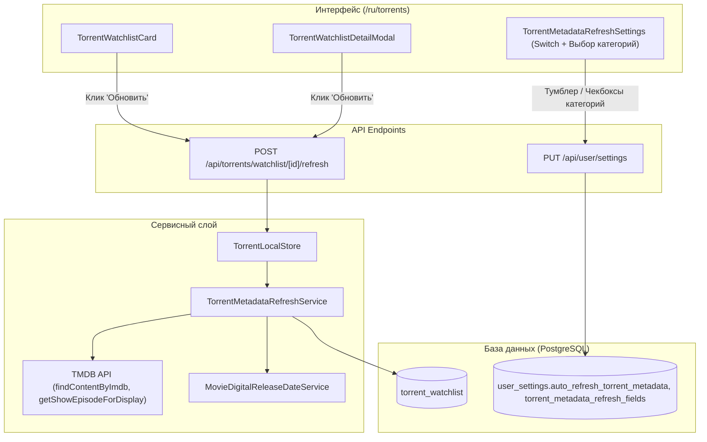

# Архитектура синхронизации метаданных торрентов и тихой сверки дат

> **Версия:** 1.1  
> **Дата:** 2026-10-16  
> **Статус:** Актуально

---

## 1. Назначение

Документ описывает механизм актуализации метаданных (название, оригинальное название, постер, жанры/категории, рейтинг, число сезонов/эпизодов, канонические цифровые даты фильмов и даты выхода серий) для записей отслеживания торрентов (`torrent_watchlist`), а также систему гранулярного выбора обновляемых полей.

Механизм предоставляет два режима работы:
1. **Ручное обновление по кнопке**: прямое обновление метаданных конкретной открытой карточки пользователем (с возможностью передачи списка полей или использования сохранённого профиля настроек).
2. **Автоматическое фоновое обновление (тихая сверка)**: опциональная фоновая сверка устаревших записей (старше 24 часов) при просмотре списка, выключенная по умолчанию, обновляющая только выбранные пользователем поля.

---

## 2. Ключевые архитектурные принципы

- **Строгая защита пользовательских настроек:** При обновлении метаданных контента из TMDB/IMDb **никогда не перезаписываются** персональные предпочтения пользователя (`preferredQuality`, `preferredAudio`, `pinnedReleaseKey`, `targetSeason`, `maxReleasesCount`, `notifyOnce`, `telegramChatId`).
- **Гранулярность обновления (Selective Field Updates):** Пользователь может выбрать, какие именно категории метаданных обновлять (например, только рейтинг и постеры, либо только категории/жанры). Невыбранные поля остаются строго неизменными в базе данных.
- **Безопасность (Security & Authorization):** Все операции обновления выполняются только от имени аутентифицированного пользователя с проверкой `userId === item.userId`.
- **Неблокирующий UI (Non-blocking Stale-While-Revalidate):** Автоматическая сверка выполняется в фоновом пуле без задержки рендеринга страницы.
- **Обратная совместимость:** Если у пользователя не задан список полей (значение по умолчанию), обновляются все категории метаданных, сохраняя поведение предыдущих версий.

---

## 3. Схема взаимодействия

---

## 4. Категории обновляемых метаданных

| Ключ поля | Название в интерфейсе | Затрагиваемые поля таблицы `torrent_watchlist` | Описание |
|---|---|---|---|
| `posters` | Постеры | `posterUrl` | Постеры и обложки тайтлов из TMDB |
| `ratings` | Рейтинг | `rating` | Баллы и оценки зрителей IMDb / TMDB |
| `genres` | Категории и жанры | `genre` | Жанровые категории и классификаторы |
| `plot` | Описание | `plot` | Синопсис и краткое содержание сюжета |
| `details` | Название и год | `title`, `originalTitle`, `year`, `runtime`, `type` | Названия на русском и языке оригинала, год премьеры, хронометраж |
| `episodes` | Сезоны и даты | `totalSeasons`, `totalEpisodes`, `nextEpisode*`, `digitalReleaseDate` | Число сезонов и эпизодов, даты премьер серий и цифровых релизов |

---

## 5. Компоненты и ответственность

| Компонент | Путь | Назначение |
|---|---|---|
| `TorrentMetadataRefreshService` | `apps/web/src/lib/services/torrent-metadata-refresh-service.ts` | Логика выборки активных полей (`computeMetadataUpdate`), единичного обновления и пакетной фоновой тихой сверки |
| `TorrentLocalStore` | `apps/web/src/lib/services/torrent-local-store.ts` | CRUD и фасад хранения торрентов с поддержкой параметра `fields` |
| `TorrentMetadataRefreshSettings` | `apps/web/src/components/torrents/torrent-metadata-refresh-settings.tsx` | UI компонент настройки автообновления и выбора категорий метаданных (Mobile First, WCAG accessible) |
| Refresh API Route | `apps/web/src/app/api/torrents/watchlist/[id]/refresh/route.ts` | HTTP эндпоинт ручного обновления с поддержкой опционального тела `{ fields: [...] }` |
| React Hook | `apps/web/src/modules/torrents/hooks.ts` | Хук `useRefreshTorrentWatchlistItem()` с поддержкой аргумента `{ id, fields }` |
| User Settings Service | `apps/web/src/lib/services/user-service.ts` | Валидация и санитизация массива `torrentMetadataRefreshFields` |

---

## 6. Конфигурация и схема БД

- `TORRENT_METADATA_STALE_MS` — порог устаревания метаданных для тихой сверки (по умолчанию `86400000` мс = 24 часа).
- Колонка `user_settings.auto_refresh_torrent_metadata` (тип `boolean`, по умолчанию `false`).
- Колонка `user_settings.torrent_metadata_refresh_fields` (тип `jsonb`, по умолчанию `["posters", "ratings", "genres", "plot", "details", "episodes"]`).
- Миграция: `apps/web/drizzle/0010_torrent_metadata_refresh_fields.sql`.
